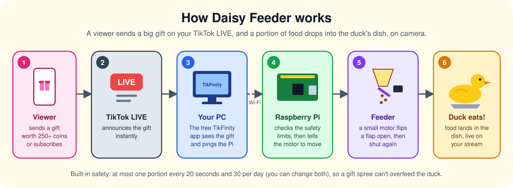
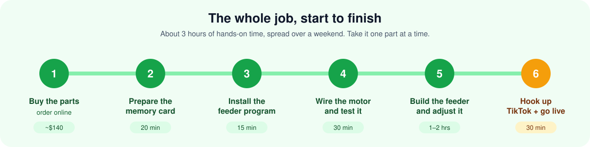
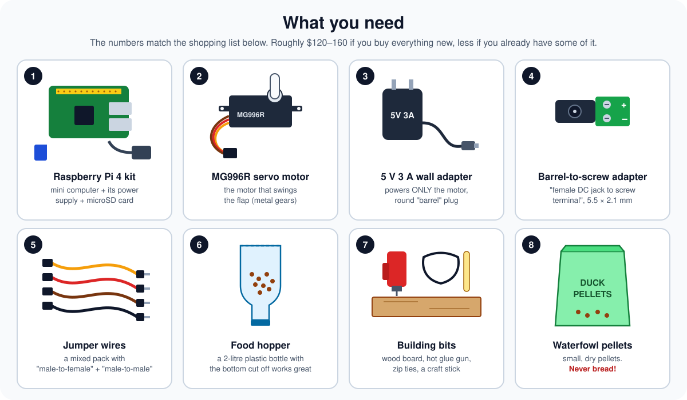
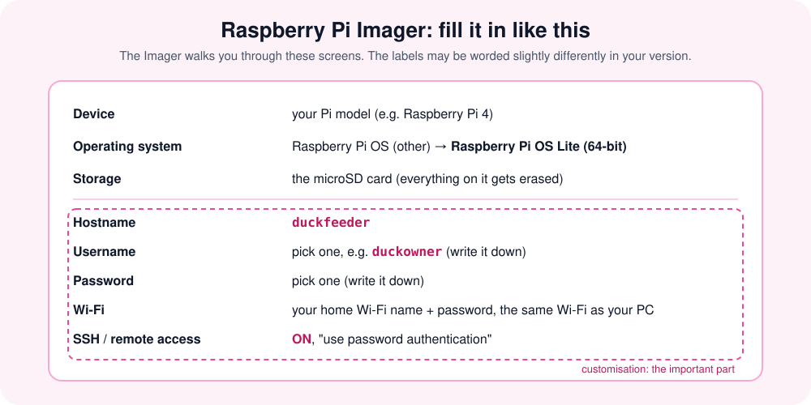
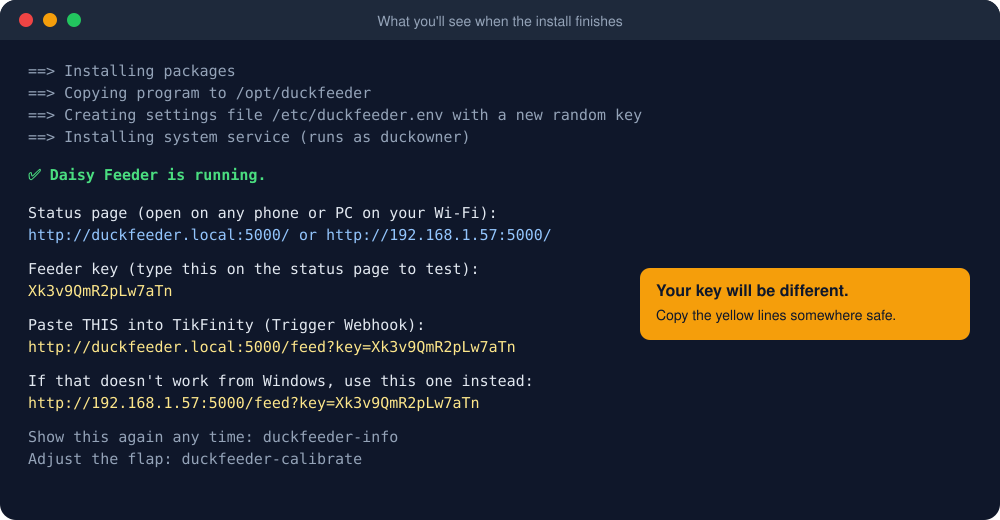
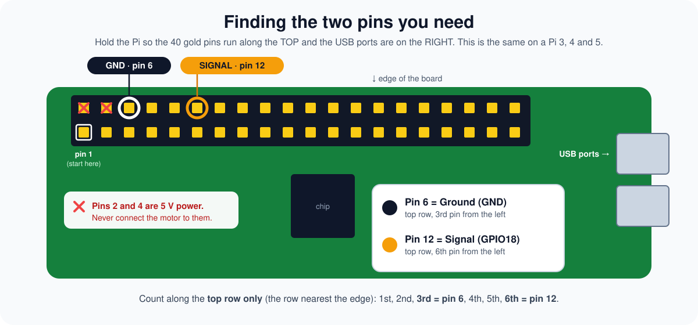
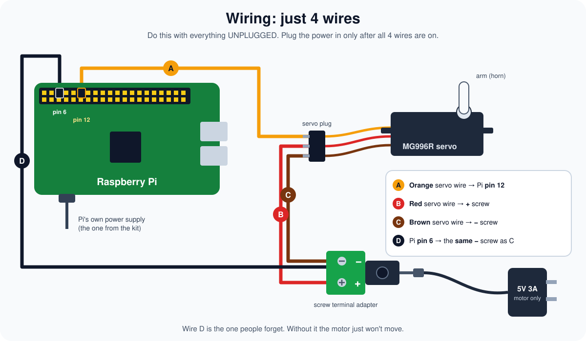
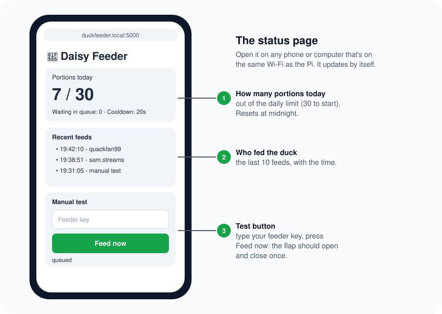
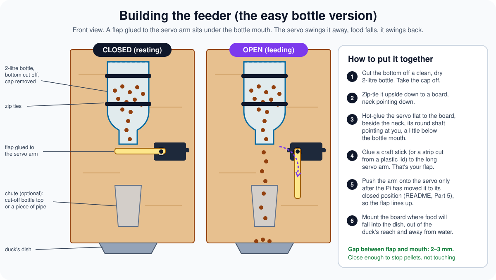
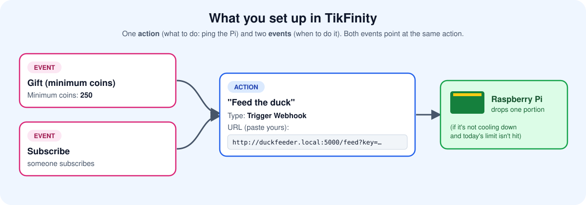

# 🦆 Daisy Feeder 1.0

**Daisy Feeder** is a TikTok LIVE duck feeder. When a viewer sends a gift worth **250 coins or more** on your TikTok LIVE (or subscribes), a small motor drops a portion of food into the duck's dish, live on camera.



**You don't need to know anything about computers or electronics to build this.** Every step is spelled out, every command can be copied and pasted, and nothing needs soldering. If you can follow a recipe and use a screwdriver, you can do this.



## Contents

1. [Buy the parts](#part-1--buy-the-parts)
2. [Prepare the memory card](#part-2--prepare-the-memory-card)
3. [Install the feeder program](#part-3--install-the-feeder-program)
4. [Wire the motor and test it](#part-4--wire-the-motor-and-test-it)
5. [Build the feeder and adjust it](#part-5--build-the-feeder-and-adjust-it)
6. [Hook up TikTok and go live](#part-6--hook-up-tiktok-and-go-live)

Also: [Before every stream](#before-every-stream) · [Changing the settings](#changing-the-settings) · [Something's not working](#somethings-not-working) · [Words you'll see](#words-youll-see) · [Looking after the duck](#looking-after-the-duck)

---

## Part 1 — Buy the parts



All of these are on Amazon, eBay, or electronics shops like Adafruit, PiShop and Micro Center. Type the words in the **"Search for"** column into the search box.

| # | What | Search for | About | Notes |
|:-:|---|---|:-:|---|
| 1 | **Raspberry Pi starter kit** | `Raspberry Pi 4 starter kit` | $70–100 | Make sure the kit includes the **power supply** and a **microSD card** (16 GB or bigger). A case is nice but optional. A Pi 3B+ or Pi 5 kit also works. |
| 2 | **Servo motor** | `MG996R servo` | $8–12 | Often sold in 2-packs, so you get a spare. Get the **MG996R** (metal gears). The tiny blue "SG90" ones are too weak. |
| 3 | **5 V wall adapter for the motor** | `5V 3A power adapter 5.5mm x 2.1mm` | $8–10 | This powers **only the motor**. It must say **5V** and **3A** (or 2A–4A). Round "barrel" plug. |
| 4 | **Barrel-to-screw adapter** | `female DC barrel jack to screw terminal adapter 5.5x2.1` | $6 | Usually a pack of several. It lets you screw wires onto the wall adapter's plug. |
| 5 | **Jumper wires** | `jumper wires male to female male to male` | $7 | Get a mixed pack that has **both** "male-to-female" and "male-to-male" wires. |
| 6 | **Food hopper** | — | free | A clean, dry **2-litre plastic bottle**. |
| 7 | **Building bits** | — | $10 | A small piece of wood (about 30 × 45 cm / 12 × 18 in), a **hot glue gun**, **zip ties**, a **craft stick** (popsicle stick). |
| 8 | **Duck food** | `waterfowl pellets` or `duck pellets` | $10–20 | Small, dry pellets flow best. **Never bread.** It's bad for ducks. |

**Things you probably already have:**

- A **Windows PC** (the one you stream from)
- A **camera pointed at the duck**: a webcam, or your phone
- A **microSD card reader**, if your PC doesn't have a card slot (`USB microSD card reader`, about $8)
- A small **screwdriver** (for the screw terminal) and **scissors or a craft knife** (for the bottle)

> [!TIP]
> Order everything at once. Parts 2 and 3 (the memory card and the program) only need the Raspberry Pi kit, so you can start those while the rest is on its way.

---

## Part 2 — Prepare the memory card

The Raspberry Pi is a tiny computer. Its "hard drive" is the microSD card, and you need to put its operating system on that card. A free program called **Raspberry Pi Imager** does it for you.

1. On your PC, go to **[raspberrypi.com/software](https://www.raspberrypi.com/software/)**, download **Raspberry Pi Imager for Windows**, and install it.
2. Put the microSD card into your PC (or into the card reader).
3. Open **Raspberry Pi Imager** and fill it in like this:



> [!IMPORTANT]
> **Write down the username and password you choose.** You'll need them in Part 3. Use the hostname `duckfeeder` exactly, because the rest of this guide uses that name.

4. Click **Write** (or **Next** until it starts). It takes 5–10 minutes. When it says it's finished, take the card out.
5. Put the microSD card into the slot on the **underside** of the Raspberry Pi. Plug in the Pi's own power supply (the one from the kit).
6. **Wait 5 minutes.** The first start-up is slow, and the Pi may restart itself once. That's normal. There's no screen; the Pi just sits there with a little light on.

---

## Part 3 — Install the feeder program

Now you'll "talk" to the Pi from your Windows PC by typing commands. It sounds technical, but you're only copying and pasting.

### Open PowerShell

Click the **Start** button, type **PowerShell**, and press **Enter**. A blue or black window with a blinking cursor opens. This is where you'll paste commands.

> [!TIP]
> **How to paste in PowerShell:** copy a command from this page (there's a copy button in the top-right corner of each grey box), then **right-click** inside the PowerShell window, or press **Ctrl + V**. Then press **Enter**.

### Connect to the Pi

Paste this, but **change `duckowner` to the username you picked in Part 2**:

```
ssh duckowner@duckfeeder.local
```

- The first time, it asks *"Are you sure you want to continue connecting?"*. Type `yes` and press **Enter**.
- Then it asks for your **password**. Type the password you picked in Part 2 and press **Enter**.

> [!NOTE]
> **When you type the password, nothing appears on screen. No dots, no stars.** That's normal and a security feature. Just type it and press Enter.

When it works, the line where you type changes to something like `duckowner@duckfeeder:~ $`. **You're now typing on the Pi.**

<details>
<summary><b>It says "Could not resolve hostname"?</b> (click to open)</summary>

- Wait a couple more minutes (the Pi may still be starting up) and try again.
- Make sure the Wi-Fi name and password in Part 2 were exactly right. If not, redo Part 2.
- Or use the Pi's number address instead: log in to your Wi-Fi router's app or web page, find the device called **duckfeeder** in its list of connected devices, and use its address, e.g. `ssh duckowner@192.168.1.57`.

</details>

### Download and install the feeder

Paste these three lines one at a time, pressing **Enter** after each. Wait for each one to finish (the cursor comes back) before pasting the next.

```
sudo apt install -y git
```

```
git clone https://github.com/Ezra-Black/daisy-feeder.git
```

```
sudo bash daisy-feeder/pi/install.sh
```

If it asks for your password again, type it (it's invisible again) and press Enter. The install takes a few minutes. When it's done you'll see something like this:



> [!IMPORTANT]
> **Save the yellow lines.** Open Notepad on your PC, highlight the lines in PowerShell with your mouse, press **Ctrl + C** to copy, and paste them into Notepad (**Ctrl + V**). Save the file somewhere safe. You need the **key** in Part 4 and the **TikFinity link** in Part 6.
>
> If you lose them, log in to the Pi again (`ssh ...` as above) and type `duckfeeder-info`. It shows them again.

The feeder program now starts by itself every time the Pi is switched on. You never have to run it by hand.

To leave the Pi, type `exit` and press Enter (or just close the window).

---

## Part 4 — Wire the motor and test it

> [!WARNING]
> **Unplug everything first:** the Pi's power and the motor's wall adapter. Only plug them back in once all 4 wires are on.

### Find the two pins

The Pi has a row of 40 little gold pins. You only use two of them.



### Connect the 4 wires



1. **Prepare the screw adapter.** Push the barrel-to-screw adapter onto the **motor's wall adapter** plug (don't plug the wall adapter into the wall yet). Loosen both screws on top a few turns with the small screwdriver.
2. **Wire A (signal):** take a **male-to-female** jumper wire. Push the **pin end** into the servo plug's **orange** hole, and push the **socket end** onto Pi **pin 12**.
3. **Wire B (power):** take a **male-to-male** wire. One end into the servo plug's **red** hole, the other end into the adapter's **+** screw hole. Tighten the screw so the wire can't pull out.
4. **Wire C (ground):** take a **male-to-male** wire. One end into the servo plug's **brown** hole, the other end into the adapter's **−** screw hole. Don't tighten it yet.
5. **Wire D (shared ground):** take a **male-to-female** wire. Push the **socket end** onto Pi **pin 6**, and the **pin end** into the **same −** screw hole as wire C. Now tighten that screw so it holds **both** wires.
6. Give each wire a gentle tug to make sure it's firm.

| Servo wire colour | Might also be | Goes to |
|---|---|---|
| **Orange** | yellow or white | Pi **pin 12** |
| **Red** | red | **+** on the screw adapter |
| **Brown** | black | **−** on the screw adapter (together with Pi **pin 6**) |

> [!CAUTION]
> **Never connect the motor's red wire to the Pi's pins.** The motor pulls more power than the Pi can give. It would make the Pi crash or restart, and could damage it. That's why the motor gets its own wall adapter.

### Power on and test

1. Plug in the **motor's wall adapter**, then the **Pi's power supply**.
2. The motor may twitch once when the Pi starts. That's it finding its "closed" position. Good sign!
3. Wait 2 minutes, then on your phone or PC (on the same Wi-Fi) open your browser and go to **`http://duckfeeder.local:5000`**. If that doesn't load, use the other address from your saved yellow lines (the one with numbers, like `http://192.168.1.57:5000`).



4. Type your **feeder key** into the box and press **Feed now**. The motor should **turn, pause half a second, and turn back.** 🎉

If it doesn't move, check [Something's not working](#somethings-not-working).

> [!TIP]
> Bookmark the status page on your phone. It's handy during streams to see how many portions the duck has had today.

---

## Part 5 — Build the feeder and adjust it



### Build it

Follow steps 1–4 and 6 in the picture above: bottle zip-tied upside down to the board, servo hot-glued flat beside the bottle's neck, craft stick glued to the long white servo arm. **Leave the arm off the servo for now.**

> [!TIP]
> The servo comes with a little bag of white plastic arms ("horns"). Use the **long single arm**. Rough up the craft stick and the arm with sandpaper or a knife before gluing, and the glue holds much better.

### Line up the flap

You'll use a little adjusting tool that moves the motor to whatever angle you type.

1. Open **PowerShell** and connect to the Pi again (same as Part 3):
   ```
   ssh duckowner@duckfeeder.local
   ```
2. Start the adjusting tool:
   ```
   duckfeeder-calibrate
   ```
   (Type your password if it asks.) The motor moves to its **closed** position.
3. Now **push the arm (with the flap) onto the servo's shaft** so the flap sits **flat under the bottle mouth, covering it**, 2–3 mm below it. It's fine if it's a little off; you'll fine-tune next.
4. **Fine-tune "closed":** type a number and press Enter to move the flap there (`0` to `180`). Try small steps like `5`, `10`, `15` until the flap covers the mouth nicely. Then type:
   ```
   closed
   ```
5. **Find "open":** type bigger numbers like `60`, `80`, `90` until the flap has swung **completely clear** of the mouth. Then type:
   ```
   open
   ```
6. **Try it:** fill the bottle with some pellets and type `test`. The flap opens, food drops, the flap closes.
7. **Choose the portion size:** the flap stays open for **0.5 seconds** at first. Longer = more food. To change it, type `time` and a number of seconds, then `test` again. For example:
   ```
   time 0.8
   ```
8. When you're happy, type `save`, then `q` to quit. The feeder starts working again automatically with your new settings.

> [!TIP]
> **Measure a portion:** put a cup under the feeder, type `test` ten times, then weigh what came out and divide by ten. Now you know how much food one gift gives. See [Looking after the duck](#looking-after-the-duck) for how to use that.

### Put it in place

Mount the board where food falls into the duck's dish. Keep the **Pi, the wires and the adapters dry and out of the duck's reach**: inside a box, behind a wall, or in a plastic food container with a hole for the wires. Point your camera so viewers can see the food drop.

---

## Part 6 — Hook up TikTok and go live

The free **TikFinity** app runs on your streaming PC. It watches your LIVE for gifts and pings the Pi when someone sends a big one.



### 1. Check the PC can reach the Pi

1. On this GitHub page, click the green **Code** button, then **Download ZIP**. Open the downloaded ZIP and click **Extract all**.
2. In the extracted folder, open **`windows`** and double-click **`Test-DuckFeeder.bat`**.
   - If Windows shows *"Windows protected your PC"*, click **More info**, then **Run anyway**.
3. It asks for the **Pi address**: type `duckfeeder.local:5000` (or the number address, like `192.168.1.57:5000`). Then it asks for your **feeder key**.
4. If it says **Reachable** in green, you're good. It also **copies your TikFinity link to the clipboard**, and offers a test feed (type `y`).

### 2. Install TikFinity

1. Go to **[tikfinity.zerody.one](https://tikfinity.zerody.one)**, download the **TikFinity Desktop App**, install it and sign in.
2. Connect it to your **TikTok username**.
3. Keep TikFinity **open whenever you're live**. If it's closed, gifts won't reach the duck.

### 3. Create the action (what happens)

1. In TikFinity, go to **Actions & Events** and click **Create new action**.
2. Name it **Feed the duck**.
3. Turn on **Trigger Webhook** (it might be under "more options" or worded slightly differently).
4. Paste your **TikFinity link** from Part 3 (the yellow line that ends in `/feed?key=...`). It looks like:
   `http://duckfeeder.local:5000/feed?key=YOUR-KEY`
5. *Optional:* also add an on-screen alert or sound to the same action, like *"🦆 {name} fed the duck!"*.
6. Save.

> [!NOTE]
> If the `duckfeeder.local` link doesn't work in TikFinity, use the **number version** of the link from your saved yellow lines instead (`http://192.168.1.57:5000/feed?key=...`).

### 4. Create the events (when it happens)

Still in **Actions & Events**, find the events section and create two:

| Event | Setting | Action |
|---|---|---|
| **Gift** with a minimum coin value | Minimum coins: **250** | Feed the duck |
| **Subscribe** | — | Feed the duck |

### 5. Your stream

Stream with **TikTok LIVE Studio** or **OBS**, whichever you already use. Just add the duck camera as a video source (in OBS: **Sources → + → Video Capture Device**). TikFinity reads gifts straight from TikTok, so it works with either.

### 6. Do a dry run

1. In TikFinity, use the **test / simulate** button on your event. The flap should open.
2. Then go LIVE privately with a friend and have them send one 250-coin gift.

**That's it, you're done!** 🦆🎉

---

## Before every stream

- [ ] **Hopper filled** with pellets (an empty hopper means paid gifts with no food)
- [ ] Pi and motor adapter **plugged in**
- [ ] Status page loads and shows today's count
- [ ] **TikFinity open** and connected
- [ ] Camera can see the dish
- [ ] Duck has fresh water

---

## Changing the settings

All the settings are in one file on the Pi. To change them, connect to the Pi (`ssh duckowner@duckfeeder.local`) and type:

```
sudo nano /etc/duckfeeder.env
```

A simple text editor opens. Use the **arrow keys** to move, change the numbers, then:

1. Press **Ctrl + O**, then **Enter**, to save
2. Press **Ctrl + X** to close the editor
3. Restart the feeder so it picks up the changes:
   ```
   sudo systemctl restart duckfeeder
   ```

| Setting | Starts at | What it does |
|---|:-:|---|
| `COOLDOWN_SECONDS` | 20 | Seconds to wait between portions, however many gifts arrive at once |
| `DAILY_MAX` | 30 | Most portions per day. After this, gifts still count on TikTok but no more food drops. Resets at midnight. |
| `OPEN_SECONDS` | 0.5 | How long the flap stays open: bigger number = bigger portion. (Easier to set with `duckfeeder-calibrate`.) |
| `PORTIONS_PER_FEED` | 1 | How many times the flap opens per gift |
| `MAX_QUEUE` | 5 | How many gifts can wait in line during the cooldown. Extras are skipped. |
| `OPEN_ANGLE` / `CLOSED_ANGLE` | 90 / 0 | Flap positions (set these with `duckfeeder-calibrate`) |
| `FEEDER_KEY` | random | The secret password in your TikFinity link. If you change it, update TikFinity too. |

**Want a different coin amount?** That's set in TikFinity, not here. Change the minimum coins on the Gift event.

---

## Something's not working

| What's happening | Try this |
|---|---|
| `duckfeeder.local` doesn't load or isn't found | Use the number address from your saved yellow lines (e.g. `192.168.1.57`). To stop that number changing, look in your router's settings for **"DHCP reservation"** or **"reserve IP"** and reserve it for **duckfeeder**. |
| Status page loads, but **the motor doesn't move** | Check **wire D** (Pi pin 6 to the − screw). It's the one people forget. Check the motor's wall adapter is plugged in, and that wire A is on **pin 12** (6th pin on the top row). |
| Motor **twitches, buzzes, or the Pi restarts** | The motor is getting power from the Pi. Make sure the servo's red wire goes to the **+ screw**, not to the Pi. |
| **"Wrong key"** on the status page, or a **403** error | The key doesn't match. Log in to the Pi and type `duckfeeder-info` to see the right one. |
| A gift arrives but **nothing happens** | Is TikFinity open and connected? Is the event set to 250 coins and linked to the action? Check the status page: has today's limit been reached, or is it still in its 20-second cooldown? |
| Food **jams** or comes out unevenly | Make the flap open wider (`duckfeeder-calibrate`, find a bigger "open" angle), use smaller pellets, or tap the bottle. Keep the pellets dry. |
| Food **trickles out while closed** | Fine-tune "closed" with `duckfeeder-calibrate` so the flap fully covers the mouth, or move the flap closer to the mouth. |
| I want to see what the Pi is doing | Connect to the Pi and type `journalctl -u duckfeeder -f` for a live log. Press **Ctrl + C** to stop. |
| Everything's broken and I want to start over | Redo Part 2 (this erases the card) and Part 3. |

---

## Words you'll see

| Word | What it means |
|---|---|
| **Raspberry Pi** ("the Pi") | A credit-card-sized computer. It runs the feeder program. |
| **microSD card** | The Pi's tiny memory card, like its hard drive |
| **Servo** | A small motor that turns to an exact angle you choose, then holds it |
| **PowerShell** | A Windows window where you type commands |
| **SSH** | A way to type commands on the Pi from your PC over Wi-Fi |
| **sudo** | Put in front of a command on the Pi to say "do this as the administrator". It may ask for your password. |
| **Hostname** | The Pi's name on your Wi-Fi: `duckfeeder` |
| **IP address** | The Pi's number address on your Wi-Fi, like `192.168.1.57` |
| **Webhook** | A web link that makes something happen when it's visited. TikFinity visits it, and the Pi drops food. |
| **Feeder key** | A secret password that's part of the link, so only TikFinity (and you) can trigger the feeder |
| **TikFinity** | A free app that watches your TikTok LIVE and does things when people send gifts |
| **GND / ground** | The "minus" side of the electricity. The Pi and the motor's adapter have to share it (wire D). |

---

## Looking after the duck

- **Set a healthy daily limit.** Multiply your portion size (from Part 5) by `DAILY_MAX`, and make sure the total isn't more than the duck should eat in a day. Check the feed bag, or ask a vet. Lower `DAILY_MAX` if needed.
- **Tell viewers about the limit.** Once it's reached, gifts still count on TikTok but no more food drops. Say so on screen, e.g. *"The duck's full for today!"*
- **The duck still gets its normal meals.** Gifts are treats on top, not the only way it eats. That's also important for TikTok's rules: keep the duck clearly well cared-for on camera, and don't suggest it only eats when people pay.
- **Pellets only, never bread.** Keep the food dry, and clean the bottle now and then.
- **Electronics away from the duck,** water and splashes.

---

## Good to know

- **Same Wi-Fi:** your streaming PC and the Pi must be on the same home network.
- **Keep your key private.** Anyone on your Wi-Fi who has the link can trigger the feeder. Don't show it on stream.
- **Never "port forward" the Pi** or put it on the internet. It doesn't need it.
- **Small gifts in a row:** 25 taps of a 10-coin gift might count differently from one 250-coin gift. Test it, and adjust the minimum in TikFinity if you want.
- **Power cuts are fine.** When power comes back, the Pi starts the feeder by itself, and remembers today's count.

---

<details>
<summary><b>For the technically curious</b> (you don't need any of this)</summary>

### What's in this repo

| File | What it is |
|---|---|
| `pi/install.sh` | One-command installer: installs packages, copies the program to `/opt/duckfeeder`, creates `/etc/duckfeeder.env` with a random key, installs and starts the systemd service |
| `pi/feeder.py` | The feeder: a small Flask server with `/feed`, `/status` and a status page; a worker thread drives the servo with cooldown, daily cap (saved across restarts) and a bounded queue |
| `pi/calibrate.py` | Interactive servo calibration; `save` writes the angles and open time into the settings file |
| `pi/duckfeeder-calibrate` | Stops the service, runs calibration, starts it again (installed to `/usr/local/bin`) |
| `pi/duckfeeder-info` | Prints service status, the key and the webhook URLs (installed to `/usr/local/bin`) |
| `pi/duckfeeder.env.example` | All settings with their defaults |
| `pi/duckfeeder.service` | systemd unit (runs as the installing user) |
| `pi/uninstall.sh` | Removes everything. `--purge` also deletes the settings and the feed count. |
| `windows/Test-DuckFeeder.bat` / `.ps1` | Checks the Pi from Windows, copies the webhook URL, sends a test feed |
| `docs/images/` | The illustrations in this README (SVG) |

### API

- `GET` or `POST /feed?key=KEY[&user=NAME]` queues one feed. The key can also be sent as an `X-Feeder-Key` header or a JSON `key` field, and the name as JSON `nickname`/`user`. Returns `403` for a wrong key, `429` when the queue is full, and `200` with `"daily limit reached"` once the cap is hit.
- `GET /status`: JSON with `fed_today`, `daily_max`, `waiting`, `cooldown_seconds`, `recent`, `mock`.
- If TikFinity supports placeholders in the webhook URL, append `&user=%nickname%` (or whatever its placeholder syntax is) to show viewer names on the status page.

### Wiring

Servo signal → GPIO18 (physical pin 12), servo power from a separate 5–6 V 2–3 A supply, common ground to physical pin 6. A different pin can be set with `SERVO_PIN` (BCM numbering).

### Run it without hardware

```bash
pip install flask
FEEDER_MOCK=1 FEEDER_KEY=test python3 pi/feeder.py
```

Then open http://localhost:5000/.

### Update to the latest version

```bash
cd ~/daisy-feeder && git pull && sudo bash pi/install.sh
```

The installer keeps your existing settings and key.

### Uninstall

```bash
sudo bash ~/daisy-feeder/pi/uninstall.sh
```

### Credits

- [TikFinity](https://tikfinity.zerody.one): free TikTok LIVE actions and webhooks
- [GTA5-TikTok-Integration](https://github.com/smeysu/GTA5-TikTok-Integration): the same TikFinity webhook pattern
- [OpenTreat](https://github.com/un1xg0d/opentreat), [rpi-feeder](https://github.com/imilchev/rpi-feeder): Pi + servo dispensers, good sources for sturdier or 3D-printed hopper designs
- [LarryBot](https://blog.hackster.io/larrybot-is-a-twitch-controlled-treat-dispenser-for-rewarding-a-good-boy-23355d865917): the cooldown idea
- [TikTokLive](https://github.com/isaackogan/TikTokLive): an alternative way for the Pi to read gifts directly (unofficial)

</details>

MIT licensed. See [LICENSE](LICENSE).
